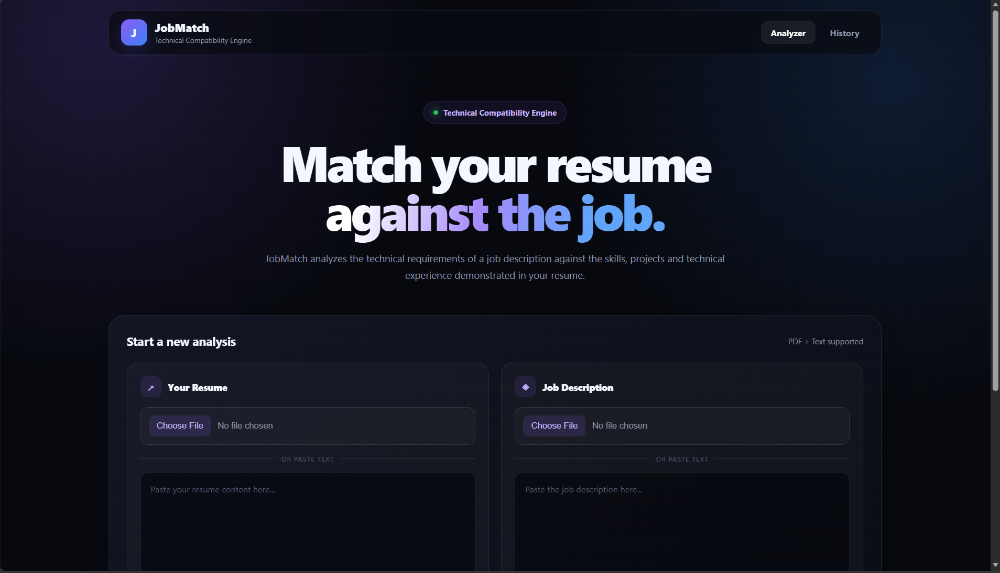
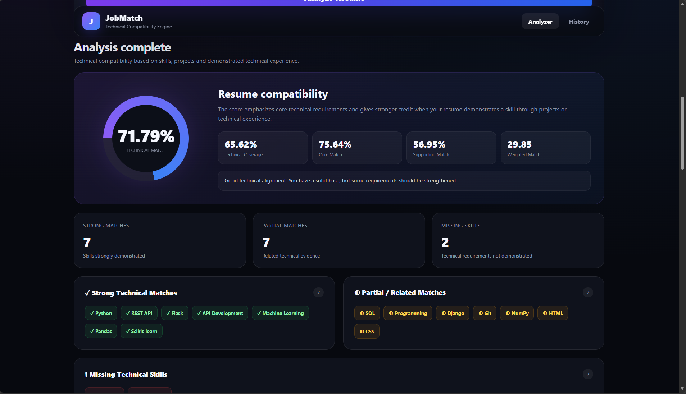
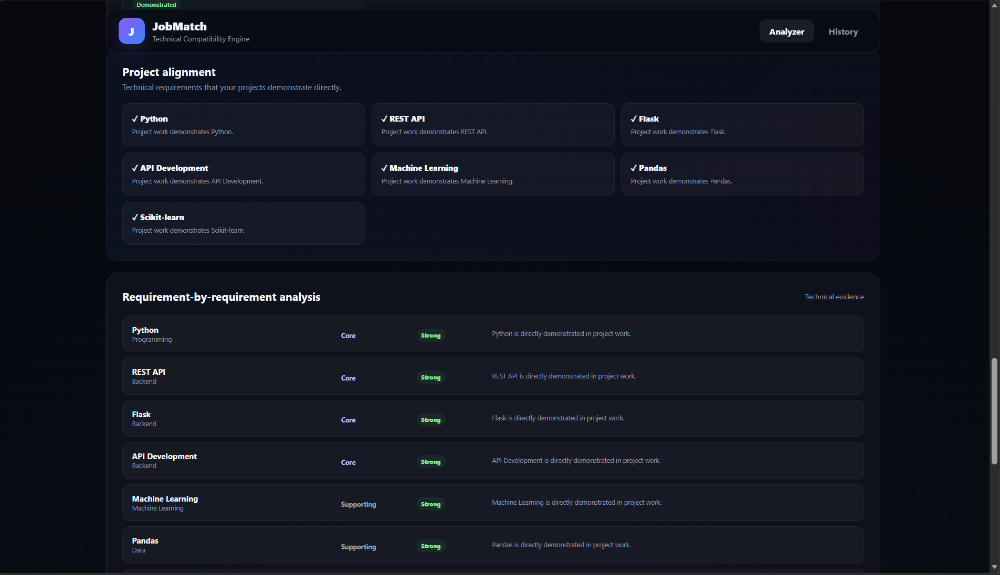

# JobMatch — Resume & Job Skill Matcher

JobMatch is a Flask-based web application that analyzes a candidate's resume against a job description and produces an explainable technical-fit analysis.

## What it does

- Accepts a resume as PDF or pasted text
- Accepts a job description as PDF or pasted text
- Extracts relevant technical skills and requirements
- Compares resume evidence with job requirements
- Separates strong, partial/related, and missing evidence
- Calculates weighted technical fit and skill coverage
- Provides requirement-level explanations
- Generates recommendations and skills-to-learn
- Shows project alignment
- Stores analysis history in SQLite
- Provides a responsive dark SaaS-style web interface

## Tech Stack

- **Backend:** Python, Flask
- **PDF processing:** pypdf
- **Database:** SQLite
- **Templating:** Jinja2
- **Frontend:** HTML, CSS, JavaScript
- **Data format:** JSON
- **Text processing:** Python regular expressions and normalization

## Core Architecture

```text
Resume PDF / Text
        │
        ▼
   Text Extraction
        │
        ├──────────────┐
        ▼              ▼
Resume Analysis   Job Description Analysis
        │              │
        └──────┬───────┘
               ▼
       Requirement Matching
               │
               ▼
       Weighted Scoring
               │
        ┌──────┴─────────┐
        ▼                ▼
  Fit & Coverage     Evidence/Gaps
        │                │
        └──────┬─────────┘
               ▼
      Recommendations
               │
               ▼
          SQLite History
```

## Main analysis concepts

### 1. Requirement extraction

The application identifies meaningful technical and professional requirements from the job description and assigns importance/weights.

### 2. Resume evidence

Resume evidence is evaluated by where and how a skill appears. Concrete project and internship evidence is treated more strongly than a simple skills-list mention.

### 3. Weighted matching

The final fit is not a raw keyword count. Higher-priority/core requirements contribute more to the score than supporting requirements.

### 4. Explainability

For every meaningful requirement, JobMatch can show whether the resume provides strong, related/partial, or missing evidence and why the score is not 100%.

### 5. Recommendations

Missing and partially covered requirements are converted into practical improvement suggestions.

## Database

The application uses SQLite for local persistence.

Key data includes:

- analysis history
- resume/job skill information
- matched and missing skills
- scores
- requirement details
- timestamps
- active analysis state for multi-step flows

## Running locally

Create and activate a virtual environment:

```powershell
python -m venv venv
.\venv\Scripts\Activate.ps1
```

Install dependencies:

```powershell
pip install -r requirements.txt
```

Run:

```powershell
python app.py
```

Then open:

```text
http://127.0.0.1:5000
```

## Important GitHub safety

Do **not** commit:

```text
.env
venv/
__pycache__/
jobmatch.db
*.pyc
```

Never commit an OpenAI/API key or any other secret.

## Project status

**Release status: Complete for portfolio use.**

The project is intentionally frozen at the working rule-based/hybrid analysis stage. An experimental semantic AI layer was explored separately, but the portfolio release does not depend on paid API credits.

That keeps the project:

- runnable locally
- reproducible
- explainable
- suitable for a fresher portfolio
- independent of an external API key

## Future scope

Possible future improvements, if the project is ever revisited:

- semantic similarity/embedding-based evidence retrieval
- stronger document structure extraction
- improved requirement classification
- deployment to a cloud platform
- authentication and multi-user storage
- automated test coverage
- production logging and monitoring

These are future possibilities, not claims about the current release.

## Portfolio description

**JobMatch — Resume & Job Skill Matcher**  
Built a Flask-based resume intelligence application that extracts skills and requirements from resumes and job descriptions, performs weighted evidence-based matching, identifies skill gaps, generates recommendations, and stores analysis history using SQLite.

---

## 🖥️ Application Preview

### 1. JobMatch Homepage

Upload a resume and job description as PDFs or paste their text to begin the analysis.



### 2. Resume Compatibility Analysis

Review the overall technical compatibility score, technical coverage, core match, and supporting match.



### 3. Skills-to-Learn Recommendations

Identify missing and partially demonstrated skills, with recommendations prioritized by importance.

![JobMatch Skills Recommendations]

### 4. Technical Skills Evidence

Explore the skills identified by the analyzer and how they are categorized based on the available resume evidence.

